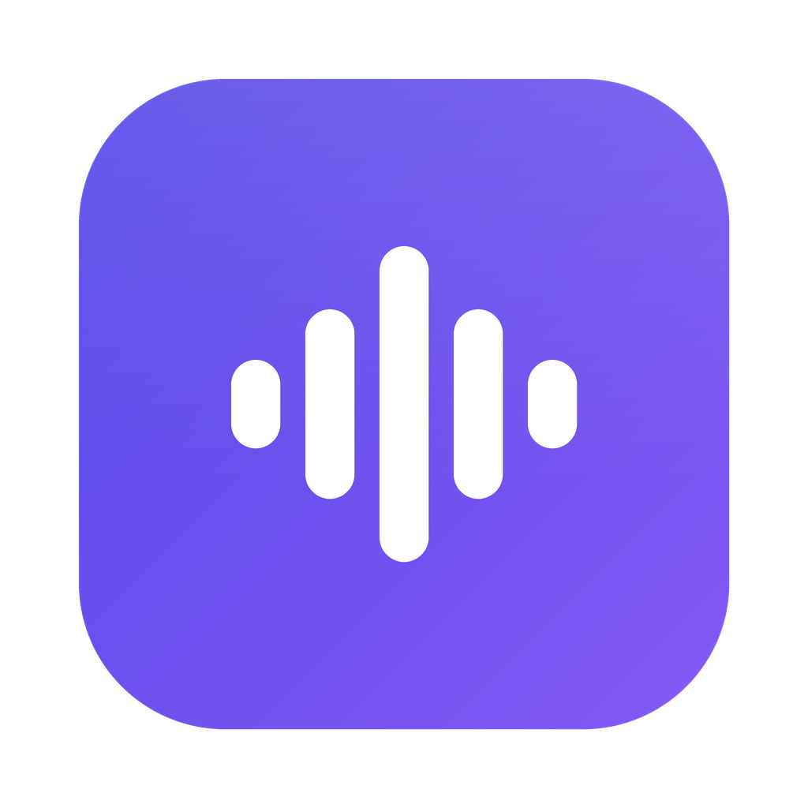
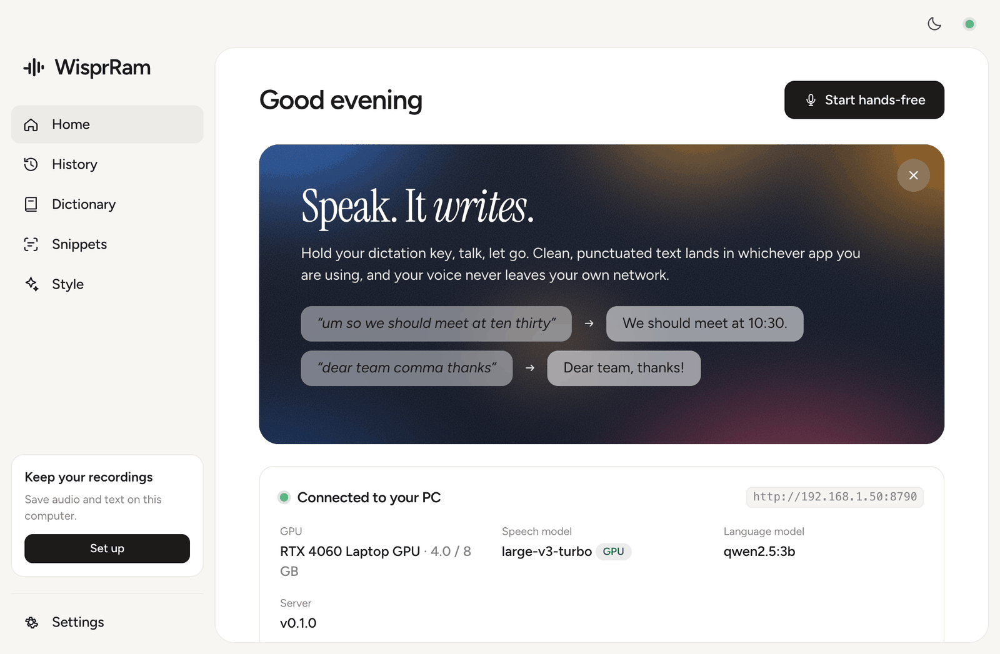
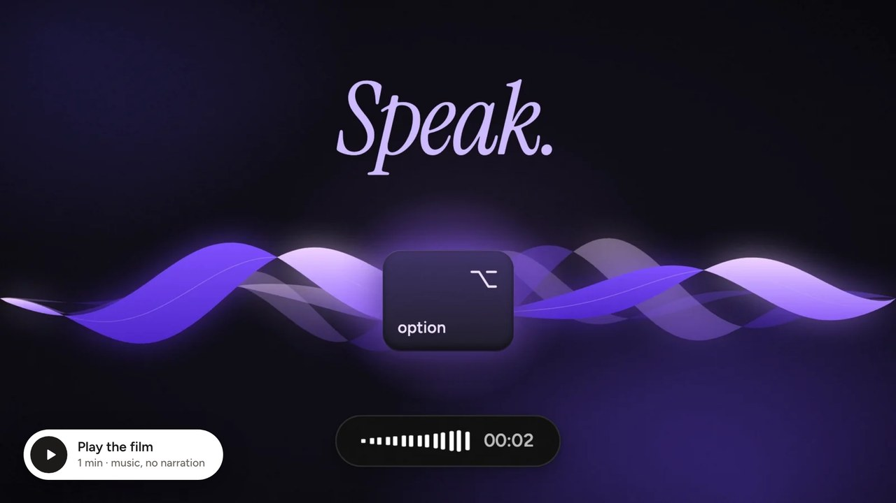
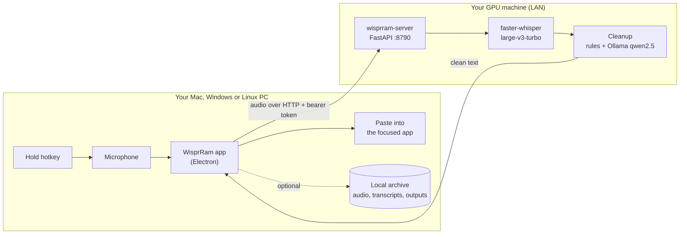
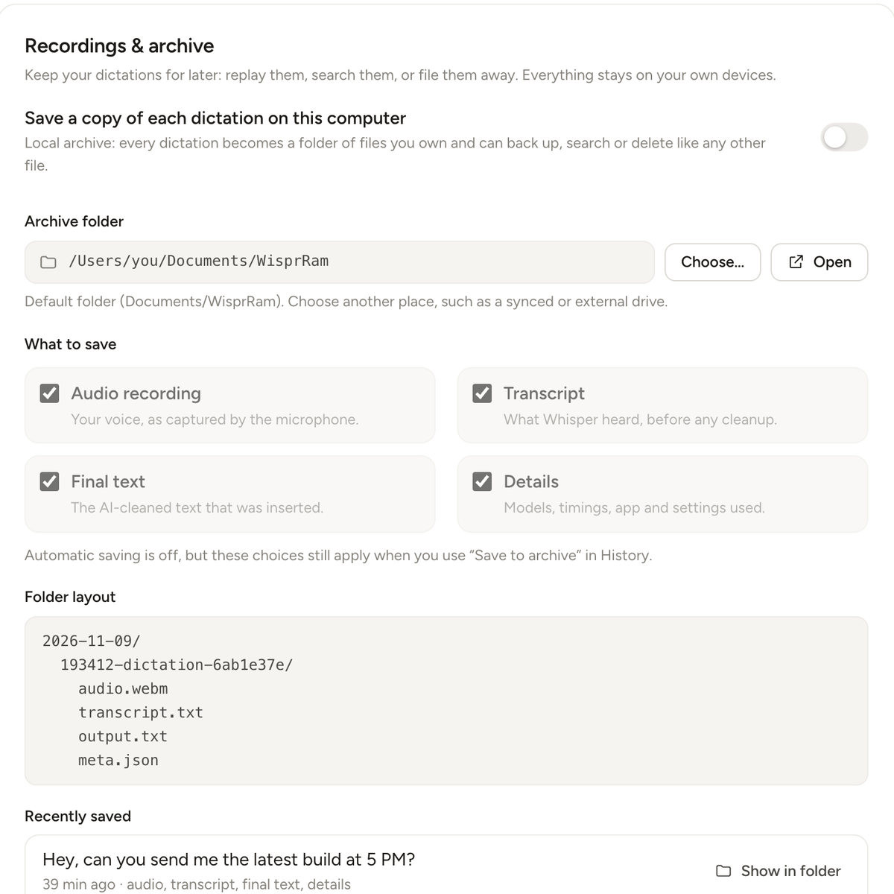

<p align="center">
  
</p>

<h1 align="center">WisprRam</h1>

<p align="center">
  <strong><em>Wispr to your RAM.</em></strong><br>
  Hold a key, speak, and clean text appears in any app.<br>
  Your voice, your GPU, your words. Nothing leaves your network.
</p>

<p align="center">
  <a href="https://github.com/OpenVibes/wisprram/releases/latest"></a>
  <a href="LICENSE"></a>
  
  
  <a href="https://github.com/OpenVibes/wisprram/actions/workflows/ci.yml"></a>
</p>

<p align="center">
  <a href="https://openvibes.github.io/wisprram/">Website</a> ·
  <a href="https://openvibes.github.io/wisprram/#film">Watch the film</a> ·
  <a href="https://github.com/OpenVibes/wisprram/releases/latest">Download</a> ·
  <a href="docs/SERVER_SETUP.md">Server setup</a> ·
  <a href="docs/CLIENT_SETUP.md">App setup</a> ·
  <a href="#faq">FAQ</a>
</p>

<p align="center">
  <picture>
    <source media="(prefers-color-scheme: dark)" srcset="docs/images/home-dark.png">
    
  </picture>
</p>

**Wispr to your RAM.** WisprRam is a self-hosted, open-source voice dictation app. You run a small server on a Linux machine with an NVIDIA GPU. It transcribes with [faster-whisper](https://github.com/SYSTRAN/faster-whisper) (`large-v3-turbo`) and tidies the text with a local LLM through [Ollama](https://ollama.com) (`qwen2.5:3b`). Lightweight desktop apps for macOS, Windows and Linux record your voice, send it to your server over your own network and paste the result into whatever app has focus.

A 3 second dictation comes back in about **0.4 seconds** on a laptop RTX 4060. No subscription, no cloud, no account.

<p align="center">
  <a href="https://openvibes.github.io/wisprram/#film">
    
  </a>
  <br>
  <a href="https://openvibes.github.io/wisprram/#film"><strong>Watch WisprRam in one minute</strong></a> (music only, no narration)
</p>

## Features

- **Push-to-talk anywhere.** Hold a key, talk, release; the text is typed into the focused app. Double-tap to lock hands-free.
- **AI cleanup.** Removes "um" and "uh", resolves self-corrections ("at 4, no, 5" becomes "at 5"), adds punctuation, handles spoken commands like "new line", turns spoken lists into lists. Levels `none`, `light`, `full`.
- **Writing styles.** Formal, casual or very casual, with per-app overrides (formal in Mail, very casual in Messages).
- **Command mode.** Select text, press a shortcut and say "make this more polite" or "translate to Spanish". The selection is replaced.
- **Personal dictionary.** Teach it names and jargon so they are heard and spelled right.
- **Snippets.** Say "my email" and get the full address.
- **History and stats.** Search everything you dictated, copy it again, see words, speed and streaks.
- **Local archive.** Optionally keep the audio, transcript, original selection and final output of every dictation in a folder on your computer. [Details](#local-archive).
- **Private by design.** Audio and text only travel between your devices and your server. [Details](#privacy).
- **Cross-platform.** macOS (Apple Silicon), Windows 10/11, Linux (deb and AppImage).

<p align="center">
  
  &nbsp;&nbsp;
  
</p>

## How it works



The app records `webm/opus` audio, posts it to `POST /v1/dictate`, and gets back the cleaned text with timings. See [docs/DESIGN.md](docs/DESIGN.md) for the pipeline and [docs/API.md](docs/API.md) for the HTTP API.

## Requirements

| | Server | App |
|---|---|---|
| OS | Linux (developed and tested on Ubuntu) | macOS on Apple Silicon, Windows 10/11 x64, Linux x64 |
| Hardware | NVIDIA GPU with 6 GB or more VRAM recommended (a CPU-only fallback works, 3x slower), 8 GB RAM, about 10 GB disk | Any machine with a microphone |
| Software | Python 3.10 to 3.12 (or [uv](https://docs.astral.sh/uv/)), [Ollama](https://ollama.com), NVIDIA driver 525 or newer | Nothing else |
| Network | The app and the server on the same LAN (or a VPN such as Tailscale) | |

You do not need the CUDA toolkit; the CUDA 12 runtime libraries come from pip wheels.

## Quick start

### 1. Start the server (on the Linux GPU machine)

Install [Ollama](https://ollama.com) first if you do not have it (`curl -fsSL https://ollama.com/install.sh | sh`), then:

```bash
git clone https://github.com/OpenVibes/wisprram && cd wisprram/backend
./scripts/install.sh --service
./scripts/run.sh pair
```

The installer checks your Python (3.10 to 3.12, or uses uv) and GPU, installs the CUDA or CPU extras, pulls the LLM through Ollama, runs a self-check, installs a systemd user service and prints the URL your clients should use (for example `http://192.168.1.50:8790`) plus the firewall command for your distro. `pair` prints a 6-digit code valid for 10 minutes. The first start downloads the 1.6 GB Whisper model.

### 2. Install the app

Download it from the [latest release](https://github.com/OpenVibes/wisprram/releases/latest) or from the [website](https://openvibes.github.io/wisprram/), which picks the right file for your OS.

| Platform | File | Notes |
|---|---|---|
| macOS (Apple Silicon) | `WisprRam-<version>-arm64.dmg` | Drag to Applications, then run `xattr -dr com.apple.quarantine /Applications/WisprRam.app` (the app is unsigned) |
| Windows 10/11 | `WisprRam-Setup-<version>.exe` | SmartScreen: More info, then Run anyway |
| Linux (Debian, Ubuntu) | `wisprram_<version>_amd64.deb` | `sudo apt install ./wisprram_<version>_amd64.deb` |
| Linux (any distro) | `WisprRam-<version>-x86_64.AppImage` | `chmod +x` and run |

### 3. Connect and talk

Open WisprRam, enter the server URL and the pairing code, grant the permissions it asks for, and try it: hold **Right Option** (macOS) or **Right Ctrl** (Windows, Linux) and speak.

Full walkthroughs: [Server setup](docs/SERVER_SETUP.md) · [App setup and permissions](docs/CLIENT_SETUP.md).

## Hotkeys

| Action | macOS | Windows / Linux |
|---|---|---|
| Hold to talk (release to insert) | Hold **Right Option** | Hold **Right Ctrl** |
| Lock hands-free | Double-tap the talk key | Double-tap the talk key |
| Hands-free on/off | **Cmd+Shift+Space** | **Ctrl+Shift+Space** |
| Command mode (edit the selection by voice) | **Cmd+Shift+E** | **Ctrl+Shift+E** |
| Cancel | **Esc** | **Esc** |

All keys can be changed in Settings. On Linux Wayland hold-to-talk only works in XWayland apps; use the hands-free shortcut ([notes](docs/CLIENT_SETUP.md#linux)).

## Local archive

Turn on **Settings, Recordings and archive** and WisprRam keeps a copy of every dictation and command on your own computer, in a folder you choose (default `~/Documents/WisprRam`):

```text
WisprRam/
  index.jsonl                        one line per item
  2026-03-14/
    093012-dictation-a1b2c3d4/
      audio.webm                     your recording
      transcript.txt                 what Whisper heard
      output.txt                     the final, cleaned text
      meta.json                      models, timings, app, language, cleanup level, style, snippets, errors
    093455-command-e5f6a7b8/
      audio.webm  transcript.txt  input.txt  output.txt  meta.json
```

<p align="center">
  
</p>

Each part can be switched off, failed requests still save the audio, and history items can be saved later with "Save to archive". The server can also keep recordings so you can replay them from History on any device. See [docs/ARCHIVE.md](docs/ARCHIVE.md).

## Privacy

WisprRam has no cloud component, no telemetry, no accounts and no analytics. Audio goes from your computer to **your** server and nowhere else. Transcription and cleanup run on your GPU. History is stored in a SQLite file on your server; the archive is a folder on your computer (its `meta.json` files record the address of your own server, so keep that in mind before sharing an archive). The one thing to know is that traffic on your LAN is plain HTTP, so only run it on a network you trust or put it behind Tailscale or WireGuard. See [SECURITY.md](SECURITY.md).

## Documentation

| | |
|---|---|
| [docs/SERVER_SETUP.md](docs/SERVER_SETUP.md) | Prerequisites, install, firewall, systemd, pairing, configuration, models, upgrade, troubleshooting |
| [docs/CLIENT_SETUP.md](docs/CLIENT_SETUP.md) | Per-OS install, onboarding, permissions, Wayland, where settings and logs live |
| [docs/ARCHIVE.md](docs/ARCHIVE.md) | Local archive and server audio retention |
| [docs/API.md](docs/API.md) | HTTP API reference with curl examples |
| [docs/DEVELOPMENT.md](docs/DEVELOPMENT.md) | Repo layout, dev loops, tests, building installers, releasing |
| [docs/DESIGN.md](docs/DESIGN.md) | Architecture, pipeline, decisions and risks |
| [CHANGELOG.md](CHANGELOG.md) · [CONTRIBUTING.md](CONTRIBUTING.md) · [SECURITY.md](SECURITY.md) | Project |

## FAQ

**Do I need an NVIDIA GPU?**
A GPU makes dictation feel instant (about 0.4 s for a short clip). Without one the server falls back to a smaller Whisper model on the CPU, around 1.5 s for a 3 second clip, which is still usable.

**Which languages work?**
Whisper large-v3-turbo handles about 100 languages and the server can auto-detect. Setting a fixed language is about 0.2 s faster. Cleanup quality in languages other than English depends on the LLM you choose; `qwen2.5` is decent in major languages.

**Can I use it away from home?**
Yes, through a VPN. Install [Tailscale](https://tailscale.com) on the server and your laptop and enter the Tailscale address as the server URL. Do not expose port 8790 to the internet.

**Why is the app unsigned?**
Code signing certificates cost money and WisprRam is a free hobby-scale project. macOS needs one `xattr` command, Windows shows a SmartScreen warning once. Build it yourself from source if you prefer ([docs/DEVELOPMENT.md](docs/DEVELOPMENT.md)).

**Hold-to-talk does nothing on macOS.**
Grant Accessibility and Input Monitoring to WisprRam, then quit and reopen it. After updating the app, remove the old entry and add it again.

**Can I use a bigger model for better cleanup?**
Yes: `ollama pull qwen2.5:7b` and set `llm_model` in Settings or the `WISPRRAM_LLM_MODEL` variable. It needs about 5 GB more VRAM and adds a few hundred milliseconds. See [docs/SERVER_SETUP.md](docs/SERVER_SETUP.md#changing-models).

**Does it work with Docker or without systemd?**
`backend/scripts/run.sh serve` runs the server in the foreground anywhere; use your own supervisor. There is no official Docker image yet.

**Is there a mobile app?**
Not yet.

## Roadmap

- Streaming partial transcripts while you speak
- Signed and notarized builds, auto-update
- Intel Mac and Windows/Linux ARM builds
- Docker image for the server
- Multi-user servers with separate histories
- Optional end-to-end TLS with built-in certificate pairing

Ideas and votes are welcome in [issues](https://github.com/OpenVibes/wisprram/issues).

## Contributing

Bug reports, ideas and pull requests are welcome. Start with [CONTRIBUTING.md](CONTRIBUTING.md) and [docs/DEVELOPMENT.md](docs/DEVELOPMENT.md). Security issues: see [SECURITY.md](SECURITY.md). Everyone taking part is expected to follow the [Code of Conduct](CODE_OF_CONDUCT.md).

## License

[MIT](LICENSE) © 2026 Anirudh Sharma. Built by [GoodLook Labs](https://github.com/OpenVibes).

## Acknowledgements

WisprRam stands on excellent open-source work: [OpenAI Whisper](https://github.com/openai/whisper), [faster-whisper](https://github.com/SYSTRAN/faster-whisper) and [CTranslate2](https://github.com/OpenNMT/CTranslate2), [Ollama](https://ollama.com), the [Qwen](https://github.com/QwenLM/Qwen2.5) models, [Electron](https://www.electronjs.org), [uiohook-napi](https://github.com/SnosMe/uiohook-napi), [FastAPI](https://fastapi.tiangolo.com) and [PyAV](https://github.com/PyAV-Org/PyAV).
