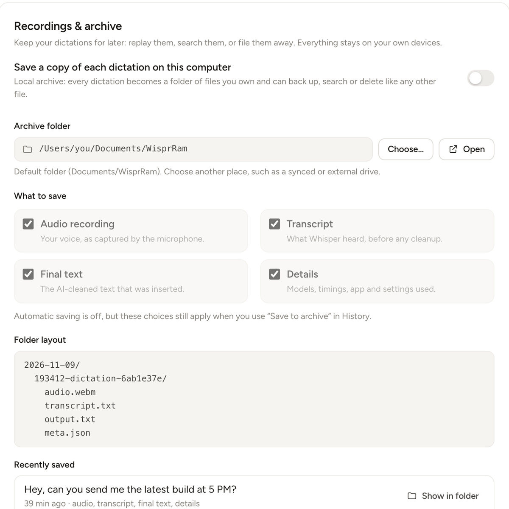

# Local archive and server audio retention

WisprRam can keep your recordings and results in two independent places:

| | Local archive | Server audio retention |
|---|---|---|
| Where | A folder on **the computer running the app** | A folder on **the server**, next to the history database |
| Setting | App: Settings, **Recordings and archive** | Server settings `save_audio` and `audio_dir` (also in the app's server settings) |
| What | Audio, transcript, input, output, metadata, per dictation | The audio of each history item |
| Default | Off | Off |
| Use it for | A personal, portable library of everything you dictated | Replaying recordings from History on any device and saving them later |

Both are off by default. Nothing is recorded to disk unless you turn it on.

## Local archive (app)

Turn it on in **Settings, Recordings and archive**. Every dictation and command is then saved in a folder you choose in Settings (default `<Documents>/WisprRam`, for example `~/Documents/WisprRam`, or `Documents\WisprRam` on Windows). The folder must be an absolute path; `~` is not expanded in the setting.



### Layout

```text
WisprRam/
  index.jsonl
  2026-03-14/
    093012-dictation-a1b2c3d4/
      audio.webm
      transcript.txt
      output.txt
      meta.json
    093455-command-e5f6a7b8/
      audio.webm
      transcript.txt
      input.txt
      output.txt
      meta.json
  2026-03-15/
    ...
```

- The first level is the **local date**, the folder is `HHMMSS-<kind>-<id8>`: local time, `dictation` or `command`, and the first 8 characters of the history id (8 random hex characters for a failed request, which has no history id). Time and date are local to your computer.
- `audio.webm`: the recording exactly as it was sent to the server (Opus in WebM; the extension follows the real format, so it can occasionally be `.ogg`, `.wav`, `.m4a`, `.mp3` or `.flac`).
- `transcript.txt`: what Whisper heard, before cleanup. For a command it is the **spoken instruction**.
- `input.txt`: **command mode only**, the text that was selected when you started.
- `output.txt`: the final text that was pasted: the AI-cleaned dictation, or the model's rewrite for a command.
- `meta.json`: everything about the run (below).
- `index.jsonl` at the root has one JSON line per write with `path`, `rel`, `files`, `kind`, `createdAt`, `preview` (first 80 characters of the output or transcript), `historyId` (if any), `mode`, `app`, `words`, `audioMs` and `error` (if any), so you can grep or load the archive without walking the folders. If the Transcript and Output toggles are off the `preview` is left out, so no text leaks into the index.
- Files are written atomically (no half-written files) and empty text files are skipped.

### What you can switch off

Settings has a toggle for each part: **Audio**, **Transcript**, **Output** and **Details** (`meta.json`). A part that is off is simply not written. If you only want text, turn Audio off.

### meta.json

```json
{
  "schema": 1,
  "source": "auto",
  "history_id": "a1b2c3d4e5f6",
  "created_at": "2026-03-14T09:30:12.418Z",
  "kind": "dictation",
  "mode": "ptt",
  "app": { "name": "Mail", "bundle_id": "com.apple.mail", "window_title": "New Message" },
  "language": "en",
  "cleanup": "full",
  "style": "casual",
  "requested": { "language": "auto", "cleanup": "full", "style": "casual" },
  "server_url": "http://192.168.1.50:8790",
  "stt_model": "large-v3-turbo",
  "llm_model": "qwen2.5:3b",
  "timings": { "decode_ms": 19, "stt_ms": 270, "llm_ms": 136, "total_ms": 426 },
  "cleanup_used": "llm",
  "applied_snippets": ["my email"],
  "audio_ms": 3100,
  "word_count": 14,
  "has_server_audio": false,
  "client": { "app": "WisprRam", "version": "0.2.0", "platform": "darwin", "arch": "arm64" },
  "files": ["audio.webm", "meta.json", "output.txt", "transcript.txt"]
}
```

Field notes:

- `mode` is `ptt`, `handsfree` or `command`.
- `source` is `auto` for items saved as you dictate and `history` for items saved later with "Save to archive".
- `cleanup_used` is `llm`, `rules` or `none`: what the server really did (it falls back to rules if the LLM misbehaves or times out).
- `error` appears when a request failed, with the reason. Fields the server never returned are `null`.
- `server_url` is the address of **your own** server, recorded so you know which machine produced the result. Keep that in mind before sharing an archive folder.
- `app` has `name` and, where the OS provides them, `bundle_id` and `window_title`.
- Exact field sets can grow between versions; `schema` is bumped for breaking changes.
- The selected text of a command goes to `input.txt` and is never copied into `meta.json`.

### What is saved, and when

- Automatic saving covers every finished dictation or command, **including empty results** (when nothing intelligible was heard).
- **Not saved**: recordings you cancel with Esc, accidental taps shorter than 0.3 s, and microphone errors.
- If the request to the server **fails** (server unreachable, speech-to-text error, timeout), the audio is **still saved**, together with a `meta.json` that records the `error`, even if the Details toggle is off. A long dictation is never lost, and you can see why it failed.
- If the archive folder cannot be written (disk full, folder removed), the dictation is still pasted; the app shows a hint instead. An archive problem never blocks pasting.
- **Save to archive**: in **History**, every item has a "Save to archive" action. It works even when the automatic archive is off. If the item was already archived it reuses that folder and fills in missing files without duplicating anything. It downloads the audio only if the server kept it (`save_audio`).

### Moving and deleting

The archive is just files. Move the folder, back it up, sync it, or delete entries in the file manager. WisprRam only appends; it never deletes archive entries and never uploads them anywhere. Changing the folder in Settings affects new items only; old ones stay where they are.

## Server audio retention

By default the server throws the audio away as soon as the text is produced. With **audio retention** on, it keeps each recording next to its history item:

| Setting | Meaning |
|---|---|
| `save_audio` | `true` keeps the recording of every new dictation and command. Default `false`. |
| `audio_dir` | Absolute folder **on the server** for kept audio. Empty (default) means `<data_dir>/audio`, normally `~/.config/wisprram/audio`. |

Set them through the app (server settings) or the API:

```bash
curl -X PUT http://SERVER:8790/v1/settings \
  -H "Authorization: Bearer $TOKEN" -H "Content-Type: application/json" \
  -d '{"save_audio": true}'
```

Effects:

- History items gain `has_audio: true` and `audio_mime`; the **History** page shows a player, so you can replay a recording from any paired device.
- `GET /v1/history/{id}` returns one item with its full processing metadata, and `GET /v1/history/{id}/audio` streams the recording. See [API.md](API.md#history).
- From History you can **Save to archive**: the app downloads the kept audio and writes it into your local archive.
- **Deleting a history item, clearing history or pruning by age (`keep_history_days`) deletes the audio files too.** Turning `save_audio` off stops keeping new audio but does not delete existing recordings.
- A kept recording uses about 8 KB per second of speech (0.5 MB per minute), so even heavy use is a few GB per year.
- If `audio_dir` is not an absolute, writable folder the server rejects the setting with `bad_audio_dir`.

The audio folder is not encrypted. Anyone with access to the server account can read it; see [../SECURITY.md](../SECURITY.md).

## Which should I use?

- Want your own copy of everything, on your own disk: **local archive**.
- Dictate from several computers and want to replay or save any item from any of them: **server retention** (and optionally the archive on each).
- Both on: the archive entry gets `has_server_audio: true` and a copy of the audio; the server keeps its own.
